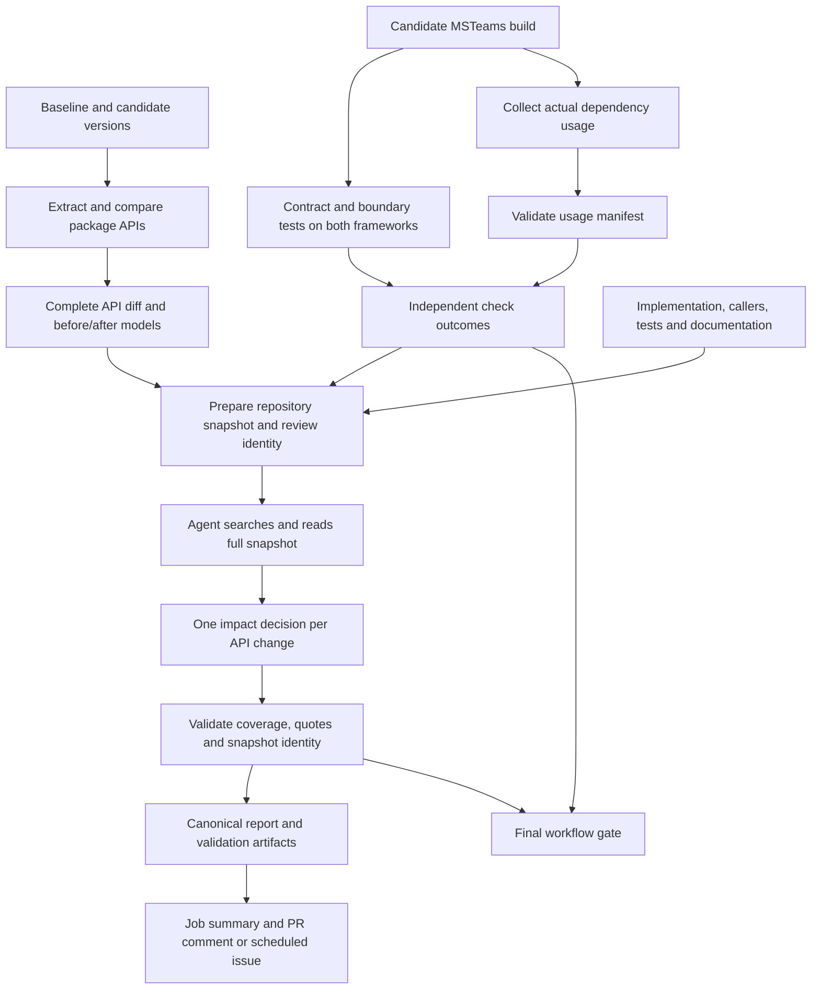

# Teams API implementation impact review

The drift workflows compare the centrally declared Microsoft.Teams.Apps baseline with a candidate package, then ask a repository review agent to assess **every API change** against the MSTeams implementation. API discovery, build/test execution, snapshot integrity, decision coverage, citation checks, and the final gate remain deterministic.

The agent makes contextual impact decisions. The workflows no longer run the rule-based `classify` command or generate a separate prose advisory report.

## Data flow

## Review decisions

Each original `MTAPI-####` change receives one decision:

| Verdict | Meaning | Gate behavior |
| --- | --- | --- |
| `safe` | Existing behavior accommodates the candidate, or the change is established to be irrelevant. | May pass after complete evidence validation and independent checks. |
| `needs-adaptation` | A concrete implementation or public-contract change is required. | Blocks adoption. |
| `needs-human-review` | Usage, behavior, coverage, upstream semantics, or a capability decision remains uncertain. | Blocks adoption until reviewed. |

The agent also records `used`, `unused`, or `uncertain` usage. The usage manifest and collected assembly references help navigate the implementation; they do not supply automatic compatibility decisions. A recorded use contradicts an `unused` claim. Existing `compatibilityReviews` entries are evidence for the agent to re-evaluate, rather than automatic approval in the active workflows.

The review prompt requires investigating helpers, callers, public exposure, routing, mappings, serialization, and relevant tests. Additive/unconsumed changes are included. Related changes can be investigated together, but none may be omitted from the response. Safe consumed changes require test citations. Uncertain usage cannot be marked safe.

## Repository snapshot and tool access

`prepare-impact-review` creates a new, empty `.teams-impact-review` workspace under the checkout, outside the source tree. It copies complete supported text files from `src/`, `docs/`, and the repository root. Supported extensions are `.cs`, `.csproj`, `.props`, `.targets`, `.md`, `.json`, `.slnx`, and `.xml`. Git-listed tracked and nonignored untracked files are included; build outputs and ignored local files are excluded. Repository instruction files are excluded from this inventory. Code assignments and credential-like JSON values are redacted. Redactions are a heuristic; the snapshot is not a general secret scanner.

The full API models are copied into `baseline-api.json` and `candidate-api.json`. `review-input.json` contains the raw comparison, usage/capability hints, checks, commit, source-file inventory, model hashes, and a SHA-256 review identity. That identity binds the entire prepared input, including normalized original-source hashes and redacted snapshot hashes. Preparation verifies that the full API models reproduce the supplied diff. Files are not truncated to prompt-sized excerpts; the agent can find and read them as needed.

The agent runs in this snapshot with only Copilot CLI `view`, `grep`, and `glob` tools available. Read operations are allowed; shell execution, edits, URL access, memory writes, built-in MCPs, custom instructions, and delegation are disabled. The snapshot contains no `.git` directory. Checkout credentials are not persisted. Copilot configuration/session state uses a separate fresh runner directory. Repository content, comments, package metadata, and previous acknowledgments are explicitly treated as untrusted evidence.

Both workflows explicitly request `gpt-5.3-codex` via `--model`. Change the job-level `COPILOT_MODEL` value in both workflow files to select another model; no repository Actions variable is required. `auto` is rejected so runs do not silently depend on a default model. Copilot CLI is pinned to `1.0.101` and automatic updates are disabled. The requested model and actual installed CLI version are printed in the review step, appended to the job summary, and saved in `impact-review-agent.json`. Each extracted final message also retains its session ID and the observed model if the CLI reports `data.model`; an absent observed model is recorded as unavailable rather than inferred. This records the requested model ID, not an immutable provider weights revision.

These controls constrain available tools; they are not an operating-system sandbox. The review is still an AI judgment. The inventory describes the supported text surface, and unavailable upstream implementation bodies or other missing evidence must lead to a human-review decision.

## Evidence validation

`validate-impact-review` checks:

- Schema, package versions, and exact review identity.
- Repository commit, source inventory, source contents, and copied package models remain unchanged.
- Exactly one decision for every change, with no unknown or duplicate IDs.
- Recognized verdicts and usage values, nonempty reasoning, and well-formed evidence arrays.
- `safe` and `needs-adaptation` decisions cite an MSTeams implementation `.cs` file.
- Safe consumed changes cite MSTeams test `.cs` files, and recorded dependency usage is not dismissed as unused.
- Every citation quotes exact complete source lines from an inventoried snapshot file.

Range-only citations are preferred: the agent supplies a source path and 1-based `startLine`/`endLine` after reading the numbered source. The validator checks bounds and extracts the exact complete source lines from the verified snapshot into the canonical evidence. This avoids transcription, indentation and JSON-escaping errors from retyping methods/tests. Empty ranges are rejected. A provided `quote` must still match the selected lines exactly. Quote-only citations also remain supported when they match uniquely; only line-ending/BOM normalization is performed, with no fuzzy matching or guessed repairs. Existence of a valid range does not establish semantic relevance; the agent must justify the chosen evidence.

The launcher requests Copilot CLI JSONL events (`--output-format json --stream off`). `review-agent-output.mjs` requires one successful terminal `result` record and extracts only the last completed main-agent `assistant.message`, excluding deltas, progress phases, tool requests/results and child-agent messages. Missing/incomplete/failed streams stop the review without falling back to a draft or earlier response. The complete event stream is retained for diagnosis and can include source excerpts returned by read/search tools from the redacted snapshot. The final message is expected to contain one plain JSON object. The response parser also accepts a single terminal JSON/untagged fence for compatibility with older responses. Multiple payloads/fences, trailing content, unknown properties, missing required fields and malformed JSON are rejected. Invalid JSON is returned for correction rather than silently repaired; every identity, coverage, source and evidence check still applies.

Citation checks establish that evidence exists. They do not prove the semantic reasoning or that quoted tests adequately cover every runtime path; the agent must explain those claims. Independent checks provide a separate gate.

## Independent checks and gate

The required checks are tool build, comparison, candidate build, drift-tool tests, usage collection, and manifest validation. PR workflows also require contract and runtime-boundary checks for `net8.0` and `net10.0`. Scheduled workflows use a combined candidate-test step that runs both categories on both frameworks. All recorded independent checks must succeed.

A review can be structurally valid while requiring adaptation or human review. Validation writes both `valid` and `canProceed`: `canProceed` requires valid evidence, all decisions safe, and every independent check passing. A safe AI decision cannot override a failing compiler, test, or manifest check. Final workflow evaluation also checks the actual step outcomes, including agent execution when required, independently of the JSON result.

No package changes produces a deterministic empty review and skips Node/Copilot installation. Fork PRs (different head/base repositories) do not run an authenticated agent: every change gets an explicit `needs-human-review` decision. Same-repository PRs can run the agent even when the repository itself is a fork. Manual and scheduled runs can run the review agent.

The launcher validates each agent response and allows at most three attempts (the initial review plus two corrections) within the workflow step timeout. Invalid structure or evidence is returned to the agent through `review-feedback.json` and `previous-review.txt` in the snapshot. Each correction must return the complete review. A structurally valid response stops the loop regardless of `canProceed`: adaptation/human-review verdicts and independent failures are never retried to seek approval. Agent execution failures and validator execution failures stop immediately. The separate validation step rechecks the final response, then the final workflow gate enforces all outcomes.

An unavailable agent, timeout, missing response, invalid evidence, changed snapshot, or omitted API change cannot pass the gate. Every attempt retains its event stream, extracted final response (when available), diagnostics, validation and report for diagnosis. The prompt explicitly prohibits review-input/API-model citations and requires real implementation evidence even for safe unused/additive changes; exact quote validation is unchanged.

## CLI commands

| Command | Inputs | Outputs |
| --- | --- | --- |
| `resolve-version` | `--props`, optional `--package` | Resolved version on stdout. |
| `compare` | `--from`, optional `--to`, `--output`, optional package sources/config | Before/after API models, complete raw diff, candidate version on stdout. |
| `collect-usage` | Repeated `--assembly`, `--output` | Compiled dependency references and source associations. |
| `validate-usage` | Manifest, collected usage, API model, repository root | Usage-integrity validation artifact and exit status. |
| `write-test-summary` | Repeated `--check name=status`, `--output` | Independent step outcomes. |
| `prepare-impact-review` | `--comparison`, `--before-api`, `--after-api`, `--manifest`, `--capabilities`, optional `--collected`, `--test-summary`, `--repository-root`, `--workspace`, `--output`, `--empty-review`, optional `--defer` | Full snapshot, trusted review input, change count on stdout, and an empty/deferred review when appropriate. |
| `validate-impact-review` | `--input`, `--review`, `--workspace`, `--repository-root`, `--output`, `--report` | Validation/gate decision, canonical citations and Markdown report. Returns 1 for invalid evidence, 0 for a structurally valid review; the workflow separately enforces `canProceed`. |
| `validate-metadata` | Built assemblies, manifests, props, optional base ref | Existing offline repository metadata checks used by normal CI. |

`classify`, `render-report`, `prepare-agent-context`, and `validate-agent-report` remain available as legacy/offline helpers for existing consumers and tests. They do not decide the active drift workflow's gate.

## Artifacts and workflow output

| Artifact | Purpose |
| --- | --- |
| `microsoft-teams-apps-before.api.json`, `microsoft-teams-apps-after.api.json` | Deterministic package API models. |
| `raw-api-diff.json` | Complete, stable-ID list of upstream API changes. |
| `collected-usage.json`, `usage-validation.json` | Independent usage evidence and manifest validation. |
| `test-summary.json` | Independent check outcomes. |
| `review-input.json` | Bound review identity and source/model hash catalog. |
| `impact-review.raw.json` | Latest extracted final assistant message, or deterministic empty/deferred review. |
| `impact-review-agent.json` | Explicitly requested model and installed CLI version. |
| `impact-review.attempt-N.events.jsonl`, `.raw.json.metadata.json` | Complete structured event stream and final-response session/model metadata. |
| `impact-review.attempt-N.raw.json`, `.stderr.log`, `.validation.json`, `.report.md` | Preserved response, execution diagnostics, validation and report for each attempt. |
| `impact-review-validation.json` | Validation errors, canonical evidence, verdict counts, and final `canProceed`. |
| `impact-report.md` | Human-readable implementation impact, evidence locations, errors and check outcomes. |

Preparation logs the number and types of API changes. Validation logs verdict counts and reasons. The final workflow step prints all required step outcomes, remaining decisions, and an explicit gate result. Reports appear in the job summary and the existing marker-based PR comment or scheduled issue. Long publication bodies are capped; complete reports and raw evidence remain in the uploaded artifacts. The temporary full source snapshot is not uploaded; the pinned commit, original/snapshot hashes, and canonical quotes identify the reviewed code.

## Main components and unchanged repository CI

`ImpactReview.cs` owns snapshot preparation, response parsing, identity/evidence validation, and report rendering. `run-impact-review.sh` defines the agent's explicit tool permissions, captures output, and bounds evidence corrections. `review-agent-output.mjs` captures the final message and agent provenance. `tests/review-agent-output.test.mjs` checks structured capture and metadata; `tests/run-impact-review-tests.sh` checks orchestration offline, including correction feedback, exhaustion, execution failures, and no retries for valid blocked reviews; both workflows run it with the drift-tool tests. `.github/instructions/teams-api-impact-review-instructions.md` defines the investigation and response contract. `Program.cs` exposes the CLI. Package extraction/comparison and `MetadataValidation.cs` remain independent components.

Ordinary `.github/workflows/ci.yml` continues to run `validate-metadata` against built MSTeams assemblies. Central package/version alignment, usage inventory, source associations, capability ownership, stale metadata, and required metadata reviews are still checked independently of the AI review. This architecture does not move Teams-specific runtime behavior into SDK Core, Builder, or Hosting.
