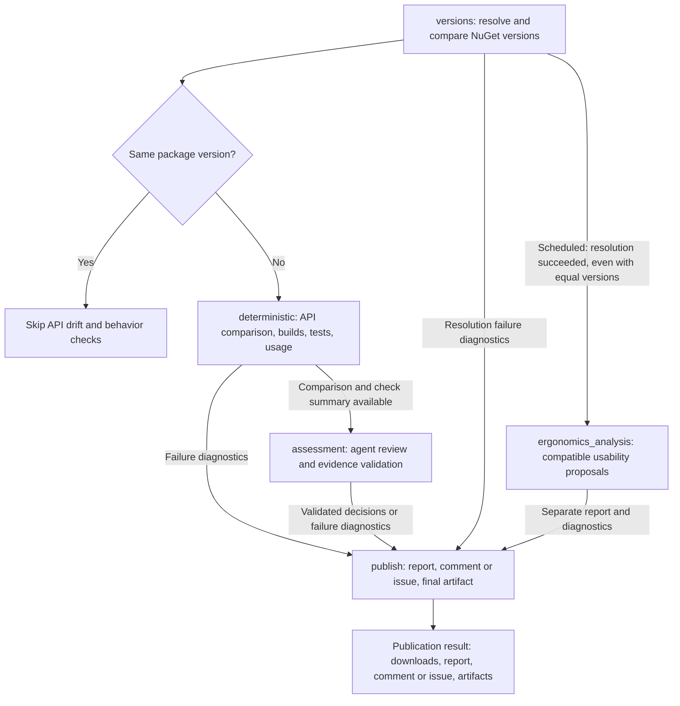

# Teams API implementation impact review

The drift workflows compare the centrally declared Microsoft.Teams.Apps baseline with a candidate package, then ask a repository review agent to assess **every API change** against the MSTeams implementation. API discovery, build/test execution, snapshot integrity, decision coverage, citation checks, and compatibility enforcement remain deterministic.

## Workflow jobs and data flow

Both workflows use the four API-review jobs below. Scheduled runs additionally run independent behavior and ergonomics analysis, described later.

| Job | Responsibility | When it runs |
| --- | --- | --- |
| `versions` | Resolve baseline/candidate versions and compare NuGet package identity. | Every triggered run. |
| `deterministic` | Extract APIs, build the candidate, run tool/contract/boundary tests, collect usage, and validate the manifest. | Only when versions differ and resolution succeeded. |
| `assessment` | Receive deterministic evidence, prepare a fresh source snapshot, run the agent, validate decisions, and enforce the impact policy. | When versions differ and comparison/check-summary evidence was transferred successfully, even if an independent check failed. |
| `publish` | Collect diagnostics, publish the review reports, upload the complete artifact, and report its own publication result. | After all dependencies finish, including failures; matching versions skip PR publication but scheduled runs still publish ergonomics results. |

The PR trigger watches only `Directory.Packages.props`, which declares the Teams API package version. Changes to extension code, tests, prompts, or workflow/tool files alone do not trigger this workflow. Changes to other dependencies in the shared props file run only version resolution when the Teams version is unchanged. Manual dispatch remains available. PR resolution retains the base-commit declaration and manual version overrides. Scheduled resolution defaults to the SDK declaration in `Directory.Packages.props` and the latest listed stable NuGet release, without extracting package APIs. Manual dispatch accepts optional `from_version` (baseline) and `to_version` (candidate) inputs; each omitted input independently retains its default. Explicit candidates bypass latest-release discovery. Version equality uses normalized NuGet package identity, including equivalent omitted version components and ignoring build metadata. Identical versions skip API drift and behavior analysis; scheduled ergonomics review and artifact publication still run. PRs retain the existing skip-all behavior. Different versions with an identical API surface still run the deterministic checks and produce an empty impact review without an AI call.

Every checkout uses the same immutable workflow commit. The assessment prepares its snapshot on its own runner, using the comparison/check summary downloaded from the deterministic job; snapshot preparation and validation happen on that same runner. Failed independent checks remain recorded in the review input and cannot be overridden by AI decisions.

Jobs transfer partial evidence using intermediate artifacts. The consuming jobs download exact producer artifact IDs, so rerunning only failed jobs can reuse successful upstream evidence without guessing an attempt number or merging stale runs. Version-resolution, deterministic and assessment artifacts contain distinct sets of files.

The final publication job uses `always()` and collects whichever artifacts were produced. It writes `pipeline-status.json`, builds a fallback Markdown report when assessment never completed, and preserves job/check outcomes alongside any assessment report. Comment/issue publication runs before the final upload; the upload itself also uses `always()`, so a publication error does not suppress the diagnostic artifact. The final and intermediate artifacts retain files for 21 days so failed jobs can be rerun with their upstream evidence during that period. Each job fails only for failures in its own steps. Publication fails for its own evidence downloads, report preparation, comment/issue publication, or artifact upload. Assessment fails for its own tool build, evidence download, snapshot preparation, agent execution, output validation, or artifact transfer, including missing review output. Neither job inherits upstream check failures or uses `canProceed` to fail its result. Deterministic checks still fail their producing job and the overall workflow; compatibility findings remain visible in reports and publication decisions even when assessment succeeds.

Only assessment jobs (API assessment and scheduled behavior/ergonomics analysis) have `copilot-requests: write`. Only publication has issue/PR-comment write permissions, and it does not check out or execute repository code. Fork PRs retain the deferred human-review behavior and cannot publish an authenticated PR comment.

## Review decisions

Each original `MTAPI-####` change receives one compatibility decision about existing extension behavior and public contracts:

| Verdict | Meaning | Gate behavior |
| --- | --- | --- |
| `safe` | Existing behavior accommodates the candidate, or the change is established to be irrelevant. | May pass after complete evidence validation and independent checks. |
| `needs-adaptation` | A concrete implementation or public-contract change is required. | Blocks adoption. |
| `needs-human-review` | Current usage, behavior, compatibility coverage, or relevant upstream semantics remain uncertain. | Blocks adoption until reviewed. |

The agent also records `used`, `unused`, or `uncertain` usage. The usage manifest and collected assembly references help navigate the implementation; they do not supply automatic compatibility decisions. A recorded use contradicts an `unused` claim. Existing `compatibilityReviews` entries are evidence for the agent to re-evaluate, rather than automatic approval in the active workflows.

The review prompt requires investigating helpers, callers, public exposure, routing, mappings, serialization, and relevant tests. Additive/unconsumed changes are included, but absence of a wrapper or dedicated test for a future feature is not itself an upgrade blocker. Bounded searches of the inventoried repository and a relevant implementation boundary can establish irrelevance; hypothetical future integrations do not require proof of non-use. Related changes can be investigated together, but none may be omitted from the response. Safe consumed changes require test citations. Uncertain usage cannot be marked safe.

Feature adoption is evaluated separately in a decision's `adoption` object (`outcome` and nonempty `reason`). Every `symbol-added`, `member-added`, and `framework-asset-added` change requires an explicit assessment: `recommend-adoption` explains the user benefit and extension changes; `no-adoption-needed` explains why the existing surface is sufficient, already exposes the addition, or excludes it by responsibility; `needs-product-decision` explains the opportunity and maintainer choice. Other changes may omit the object or use null. All three outcomes remain nonblocking for compatibility. Missing assessments and malformed objects invalidate the response and use the existing correction attempts, but a complete assessment never requires implementing the feature or resolving a product choice before upgrading. Compatibility reasoning and source/test evidence remain mandatory. Capability hints such as `adoptionPolicy: review-new-members` guide adoption evaluation rather than automatically blocking upstream additions. Related changes may reuse identical assessments; the report groups them by outcome/reason while counts remain per change.

The trusted prompt applies adoption rules in order. Required migrations belong in compatibility; an addition used solely to replace a removed/changed API receives `no-adoption-needed` with a reference to the related changes. Existing public access, such as a newly available client method, can also make a wrapper unnecessary. Useful additions that follow an existing extension pattern normally receive `recommend-adoption`: generic event handling alone does not establish parity with comparable typed routes, fluent builders and attributes. `needs-product-decision` requires a concrete unresolved choice about new responsibilities or material tradeoffs, such as storage, retention, consent, credential ownership or runtime lifetimes, supported by the inspected APIs. Implementation effort or the option to leave a routine gap unfilled is insufficient by itself. Related changes forming one proposal must reuse identical outcome/reason text so they group together; independent proposals retain separate assessments. There are no outcome quotas.

`review-new-members` guides useful parity within the mapped capability; `review-internal-additions` guides improvements to internal mappings/helpers without implying a new public feature; `advisory-only` creates no parity expectation. These hints do not expand extension responsibilities. The trusted prompt includes the repository's upstream-alignment and extension-boundary policies: use upstream models/contracts, migrate or remove exposed upstream features when required, and keep Teams-specific implementation in MSTeams. It also distinguishes test-source coverage from recorded candidate execution; tests prevented from running by a compilation failure cannot be described as passing validation. These are instructions for the agent's contextual judgment, not semantic guarantees provided by the structural validator.

## Repository snapshot and tool access

`prepare-impact-review` creates a new, empty `.teams-impact-review` workspace under the checkout, outside the source tree. It copies complete supported text files from `src/`, `docs/`, and the repository root. Supported extensions are `.cs`, `.csproj`, `.props`, `.targets`, `.md`, `.json`, `.slnx`, and `.xml`. Git-listed tracked and nonignored untracked files are included; build outputs and ignored local files are excluded. Repository instruction files are excluded from this inventory. Code assignments and credential-like JSON values are redacted. Redactions are a heuristic; the snapshot is not a general secret scanner.

Before writing the agent input, PDB source-file hints are mapped to unique canonical paths in the source inventory, accepting relative paths and Windows/Linux/SourceLink build prefixes from other runners. The agent receives only snapshot-relative hints. Unknown or ambiguous hints are omitted and counted in `unmappedSourceFileCount`, which is bound into the review identity; omission is not proof of no usage. The original `collected-usage.json` artifact retains the unmodified PDB paths for audit. No original PDB path is followed to read a file.

The full API models are copied into `baseline-api.json` and `candidate-api.json`. `review-input.json` contains the raw comparison, usage/capability hints, checks, commit, source-file inventory, model hashes, and a SHA-256 review identity. That identity binds the entire prepared input, including normalized original-source hashes and redacted snapshot hashes. Preparation verifies that the full API models reproduce the supplied diff. Files are not truncated to prompt-sized excerpts; the agent can find and read them as needed.

The launcher changes its process working directory to the snapshot and also supplies it to Copilot CLI with `-C`. The prompt requires snapshot-relative tool paths and instructs the agent to retry denied checkout paths using the inventory. Access outside the snapshot is not added. The agent runs with only Copilot CLI `view`, `grep`, and `glob` tools available. Read operations are allowed; shell execution, edits, URL access, memory writes, built-in MCPs, custom instructions, and delegation are disabled. The snapshot contains no `.git` directory. Checkout credentials are not persisted. Copilot configuration/session state uses a separate fresh runner directory. Repository content, comments, package metadata, and previous acknowledgments are explicitly treated as untrusted evidence.

Both assessment jobs explicitly pass their configured `COPILOT_MODEL` via `--model`. The `TEAMS_API_REVIEW_MODEL` repository Actions variable overrides the fallback configured in each workflow. `auto` is rejected so runs do not silently depend on a default model. Copilot CLI is pinned to `1.0.101` and automatic updates are disabled. The requested model and actual installed CLI version are printed in the review step, appended to the job summary, and saved in `impact-review-agent.json`. Each extracted final message also retains its session ID and the observed model if the CLI reports `data.model`; an absent observed model is recorded as unavailable rather than inferred. This records the requested model ID, not an immutable provider weights revision.

These controls constrain available tools; they are not an operating-system sandbox. The review is still an AI judgment. The inventory describes the supported text surface. Missing upstream behavior or other evidence that prevents assessing affected existing behavior/contracts must lead to a human-review compatibility decision; uncertainty about future adoption belongs in a nonblocking `needs-product-decision` assessment.

## Evidence validation

`validate-impact-review` checks:

- Schema, package versions, and exact review identity.
- Repository commit, source inventory, source contents, and copied package models remain unchanged.
- Exactly one decision for every change, with no unknown or duplicate IDs.
- Recognized compatibility verdicts and usage values, nonempty reasoning, and well-formed evidence arrays.
- A recognized adoption outcome with nonempty reasoning for every addition (and for any adoption object supplied on another change).
- `safe` and `needs-adaptation` decisions cite an MSTeams implementation `.cs` file.
- Safe consumed changes cite MSTeams test `.cs` files, and recorded dependency usage is not dismissed as unused.
- Every citation quotes exact complete source lines from an inventoried snapshot file.

Range-only citations are preferred: the agent supplies a source path and 1-based `startLine`/`endLine` after reading the numbered source. The validator checks bounds and extracts the exact complete source lines from the verified snapshot into the canonical evidence. This avoids transcription, indentation and JSON-escaping errors from retyping methods/tests. Empty ranges are rejected. A provided `quote` must still match the selected lines exactly. Quote-only citations also remain supported when they match uniquely; only line-ending/BOM normalization is performed, with no fuzzy matching or guessed repairs. Existence of a valid range does not establish semantic relevance; the agent must justify the chosen evidence.

The launcher requests Copilot CLI JSONL events (`--output-format json --stream off`). `ReviewAgentOutput.cs` requires one successful terminal `result` record and extracts only the last completed main-agent `assistant.message`, excluding deltas, progress phases, tool requests/results and child-agent messages. Missing/incomplete/failed streams stop the review without falling back to a draft or earlier response. The complete event stream is retained for diagnosis and can include source excerpts returned by read/search tools from the redacted snapshot. The final message is expected to contain one plain JSON object. The response parser also accepts a single terminal JSON/untagged fence for compatibility with older responses. Multiple payloads/fences, trailing content, unknown properties, missing required fields and malformed JSON are rejected. Invalid JSON is returned for correction rather than silently repaired; every identity, coverage, source and evidence check still applies.

Citation checks establish that evidence exists. They do not prove the semantic reasoning or that quoted tests adequately cover every runtime path; the agent must explain those claims. Independent checks provide a separate gate.

## Independent checks and gate

The required checks are tool build, comparison, candidate build, drift-tool tests, usage collection, and manifest validation. PR workflows also require contract and runtime-boundary checks for `net8.0` and `net10.0`. Scheduled workflows use a combined candidate-test step that runs both categories on both frameworks. All recorded independent checks must succeed.

A review can be structurally valid while requiring adaptation or human review. Validation writes both `valid` and `canProceed`: `canProceed` requires valid evidence, all compatibility decisions safe, and every independent check passing. This combined readiness result is retained for reporting and publication decisions; it does not determine the assessment job's status. The three adoption outcomes are counted separately and do not enter the compatibility policy; coverage and well-formedness of the adoption assessment are required for a valid review. A safe AI decision cannot override a failing compiler, test, or manifest check in the deterministic job. Each enforcement step checks its own job's actual step outcomes, including agent execution when required.

Identical package versions skip API drift and behavior checks, while scheduled ergonomics review and publication still run. Different versions with no API changes produce a deterministic empty impact review and skip Node/Copilot installation in API assessment. Fork PRs (different head/base repositories) do not run an authenticated agent: every change gets an explicit `needs-human-review` decision. Same-repository PRs can run the agent even when the repository itself is a fork. Manual and scheduled runs can run the review agent.

The launcher validates each agent response and allows at most three attempts (the initial review plus two corrections) within the workflow step timeout. Invalid structure or evidence is returned to the agent through `review-feedback.json` and `previous-review.txt` in the snapshot. Each correction must return the complete review. A structurally valid response stops the loop regardless of `canProceed`: adaptation/human-review verdicts and independent failures are never retried to seek approval. Agent execution failures and validator execution failures stop immediately. The separate validation step rechecks the final response, then the assessment job enforces its required step outcomes.

An unavailable agent, timeout, missing response, invalid evidence, changed snapshot, or omitted API change cannot pass the gate. Every attempt retains its event stream, extracted final response (when available), diagnostics, validation and report for diagnosis. The prompt explicitly prohibits review-input/API-model citations and requires real implementation evidence even for safe unused/additive changes; exact quote validation is unchanged.

## CLI commands

| Command | Inputs | Outputs |
| --- | --- | --- |
| `write-agent-metadata` | `--output`, `--model`, `--cli-version` | Requested model and CLI version JSON, console summary, and optional GitHub step summary. |
| `extract-agent-response` | `--input`, `--output` | Final assistant response and session/model metadata; incomplete or failed event streams are rejected. |
| `resolve-version` | `--props`, optional `--package` | Resolved version on stdout. |
| `resolve-comparison` | `--from`, optional `--to`, `--output`, optional sources/config | Normalized baseline/candidate and `sameVersion` JSON. Omitted candidate resolves the latest listed stable release using metadata only. |
| `compare` | `--from`, optional `--to`, `--output`, optional package sources/config | Before/after API models, complete raw diff, candidate version on stdout. |
| `collect-usage` | Repeated `--assembly`, `--output` | Compiled dependency references and source associations. |
| `validate-usage` | Manifest, collected usage, API model, repository root, optional `--skip-manifest-version-check` | Usage-integrity validation artifact and exit status. Scheduled workflow dispatches with an explicit `from_version` skip only the manifest/API-model version match, recording mismatches as warnings; all other checks remain required. |
| `write-test-summary` | Repeated `--check name=status`, `--output` | Independent step outcomes. |
| `prepare-impact-review` | `--comparison`, `--before-api`, `--after-api`, `--manifest`, `--capabilities`, optional `--collected`, `--test-summary`, `--repository-root`, `--workspace`, `--output`, `--empty-review`, optional `--defer` | Full snapshot, trusted review input, change count on stdout, and an empty/deferred review when appropriate. |
| `validate-impact-review` | `--input`, `--review`, `--workspace`, `--repository-root`, `--output`, `--report` | Validation/readiness decision, canonical citations and Markdown report. Returns 1 for invalid evidence, 0 for a structurally valid review; `canProceed` is reported without failing the assessment job. |
| `validate-metadata` | Built assemblies, manifests, props, optional base ref | Existing offline repository metadata checks used by normal CI. |

## Artifacts and workflow output

| Artifact | Purpose |
| --- | --- |
| `microsoft-teams-apps-before.api.json`, `microsoft-teams-apps-after.api.json` | Deterministic package API models. |
| `raw-api-diff.json` | Complete, stable-ID list of upstream API changes. |
| `collected-usage.json`, `usage-validation.json` | Independent usage evidence and manifest validation. |
| `versions.json`, `version-resolution.log`, `version-tool-build.log` | Resolved versions, skip decision and early resolver diagnostics. |
| `pipeline-status.json` | Upstream job outcomes and artifact-collection results, including incomplete/failed runs. |
| `test-summary.json` | Independent check outcomes. |
| `review-input.json` | Bound review identity, canonical snapshot-relative source hints, unmapped-hint count, and source/model hash catalog. |
| `impact-review.raw.json` | Latest extracted final assistant message, or deterministic empty/deferred review. |
| `impact-review-agent.json` | Explicitly requested model and installed CLI version. |
| `impact-review.attempt-N.events.jsonl`, `.raw.json.metadata.json` | Complete structured event stream and final-response session/model metadata. |
| `impact-review.attempt-N.raw.json`, `.stderr.log`, `.validation.json`, `.report.md` | Preserved response, execution diagnostics, validation and report for each attempt. |
| `impact-review-validation.json` | Validation errors, canonical evidence, compatibility verdict counts, adoption assessments and per-outcome counts, and final `canProceed`. |
| `impact-report.md` | Human-readable implementation impact, evidence locations, errors and check outcomes. |

Preparation logs the number and types of API changes. Validation logs compatibility verdict counts/reasons and separately labels every adoption outcome/reason as nonblocking, with counts for recommendations, no adoption needed, and product decisions. The report shows assessed/total additions and groups related assessments. The deterministic and assessment jobs print required step outcomes and remaining decisions; publication records all job results and checks only its own publication steps. Reports appear in the job summary and the existing marker-based PR comment or scheduled issue. Long publication bodies are capped; complete reports and raw evidence remain in the uploaded artifacts. The temporary full source snapshot is not uploaded; the pinned commit, original/snapshot hashes, and canonical quotes identify the reviewed code.

## Main components and unchanged repository CI

`ImpactReview.cs` owns snapshot preparation, response parsing, identity/evidence validation, and report rendering. `run-review.sh` defines the agent's explicit tool permissions, captures output, and bounds evidence corrections. `run-impact-review.sh` and `run-behavior-review.sh` are thin wrappers that select each review's prompt, input, validator, and artifact prefix. `ReviewAgentOutput.cs` captures the final message and agent provenance through the `extract-agent-response` and `write-agent-metadata` tool commands. `ReviewAgentOutputTests.cs` checks structured capture and metadata with xUnit; `tests/run-impact-review-tests.sh` checks orchestration offline, including correction feedback, exhaustion, execution failures, and no retries for valid blocked reviews; both workflows run it with the drift-tool tests. `tests/workflow-jobs-tests.sh` checks actual workflow job conditions and executes the embedded Bash report/publication-result steps across failure/skip scenarios using `jq`. Report preparation and publication-result evaluation require no checkout, Node setup, or drift-tool compilation in the publication job; comment/issue publication retains GitHub Script for GitHub API access. Node setup in the assessment job is retained for installing Copilot CLI through npm, rather than for repository scripts or tests. `.github/instructions/teams-api-impact-review-instructions.md` defines the investigation and response contract. `Program.cs` exposes the CLI. Package extraction/comparison and `MetadataValidation.cs` remain independent components.

`DriftPipeline.cs` retains the shared version resolver, capability matching, snapshot redaction and symlink-traversal checks used by the active workflows and metadata validation. The implementation-review and metadata-validation tests retain coverage of these active behaviors.

Ordinary `.github/workflows/ci.yml` continues to run `validate-metadata` against built MSTeams assemblies. Central package/version alignment, usage inventory, source associations, capability ownership, stale metadata, and required metadata reviews are still checked independently of the AI review. This architecture does not move Teams-specific runtime behavior into SDK Core, Builder, or Hosting.

## Scheduled outbound behavior analysis

The scheduled workflow also runs `behavior_analysis` after successful version resolution when package versions differ. It depends only on `versions`, so an unchanged API surface or a failed API build/review cannot suppress behavior analysis. Matching versions skip behavior analysis; ergonomics review still runs. PR workflows retain their existing behavior.

`behaviors.json` is a schema-1 catalog of stable behavior/check IDs, descriptions, source-navigation hints and review criteria. Its first behavior, `streaming-responses`, covers transport/serialization, informative updates, cumulative text and stream metadata, finalization/empty streams, reuse, attachments, citations, AI/sensitivity/feedback metadata, cancellation, timeout, disabled-streaming fallback and protocol-relevant ordering/throttling. Future behaviors add catalog entries and use the same review machinery.

`prepare-behavior-review --repository-root ROOT --workspace NEW_DIR --catalog FILE --to VERSION --output FILE` produces a hash-bound `behavior-input.json` and two source inventories. Agents source is exported from the immutable checkout HEAD; the candidate Teams package's nuspec must identify Microsoft.Teams.Apps, the requested version, the allowlisted microsoft/teams.net repository, and a full commit SHA. Source archives are fetched at those exact commits. No default-branch or tag fallback is used. Missing package/source/provenance fails preparation. Supported source/model/build/document/test files retain their revision-specific paths, including upstream directory moves. Instruction files and Git metadata are excluded; credential-like source values are redacted using the existing heuristic. Snapshots include hashes of the reviewed content, package versions and source commits bound into the review identity.

The pinned model/CLI and read/search restrictions are shared with API review through `run-review.sh`; each wrapper supplies its prompt, input, validator and artifact prefix, while the workflow supplies its workspace. The agent compares Agents against candidate Teams for every catalog check. It reports wire-level differences without attributing them to a particular Teams release. Baseline/candidate comparison remains part of the separate API impact analysis. It traces final JSON and HTTP dispatch, treats source as evidence rather than instructions, and reports source-based analysis rather than captured traffic. Internal implementation differences and diagnostic headers are excluded. Source inference is not proof of service acceptance.

`validate-behavior-review --input FILE --review FILE --workspace DIR --output FILE --report FILE` validates schema/identity, unchanged snapshot contents, exact check coverage and nonempty 1-based inclusive citation ranges. Equivalent/different conclusions require Agents and candidate citations. Inconclusive results explain missing evidence. Differences include wire effect, potential compatibility impact and follow-up. Validation resolves exact quotes into the canonical JSON. The agent supplies a short plain-language title and concise reader-facing fields; the Markdown report shows a summary, potential impact, next step, and source references without code blocks. Source links use the reviewed GitHub repository and commit, including the checkout's origin for Agents. Local fixtures or sources without a verified GitHub commit retain labeled snapshot references rather than invented upstream links. Structural checks validate evidence integrity, not the semantic truth of the agent's judgment.

Valid `equivalent`, `different` and `inconclusive` decisions all return success. Every catalog decision, including matches, remains in the JSON for coverage validation; the readable report displays only differences and inconclusive results. When all checks match, it states that no differences or inconclusive results were found. Invalid structure/evidence gets at most three correction attempts; valid findings never cause retries. Agent execution and incomplete event streams fail immediately. The final validator writes `behavior-review-validation.json` and `behavior-report.md`; preparation logs, provenance/input, agent metadata, attempt outputs and validation diagnostics are transferred with an exact artifact ID. Source snapshots remain local to the runner; the validation JSON retains detailed reasoning and cited source quotes.

Publication downloads behavior diagnostics into a separate subdirectory, appends a dedicated Teams specific behavior analysis section after the implementation impact review, and creates/updates the issue for behavior differences or inconclusive results even with an empty API diff. Findings are advisory and do not change compatibility gating. Operational/validation/transfer failures fail the behavior job; publication still preserves available evidence and job outcomes. Retention remains 21 days.

Offline coverage lives in BehaviorReviewTests, the shared launcher tests, and workflow publication tests. These cover source identity/provenance, moved paths, integrity, coverage, evidence rules, advisory outcomes, correction/execution failures, independent job conditions and behavior-only publication.

## Compatible API ergonomics review

The scheduled workflow runs `ergonomics_analysis` on every scheduled/manual invocation whose version resolution succeeds, including equal versions. It depends only on `versions`; deterministic checks, impact assessment and behavior analysis cannot suppress it. Findings are advisory, while preparation, agent, validation and artifact-transfer failures fail their own job.

`prepare-ergonomics-review --to VERSION --catalog FILE --repository-root DIR --workspace DIR --output FILE` captures the immutable Agents checkout and resolves its baseline from the captured `Directory.Packages.props`. Manual `from_version` overrides apply only to drift comparison. The declared baseline is the primary design reference; the resolved candidate supplies additional inspiration. Baseline/candidate package provenance and commit-matched source download reuse the behavior pipeline. Equal package identities share one download but retain both source roles. Snapshots retain full supported source/docs/test inventories, including shared APIs and generators, with existing redaction and archive/path safeguards. Source roles, commits, catalog and file hashes are bound into the review identity.

`ergonomics.json` covers discoverability, readability, consistency, typed values, routing/helpers and documentation/examples. `run-ergonomics-review.sh` selects the dedicated prompt and validator using the shared read/search-only runner, model/CLI configuration and three-attempt evidence-correction policy. Each catalog check receives recommendations, no-improvement, or inconclusive. Every recommendation includes the affected API/project, concrete problem, additive design, current/proposed C# caller examples, benefit, compatibility reasoning and implementation tests. Existing `ActivityTypes` constants must be considered before proposing helpers for string-valued APIs such as `IActivity.Type`. Shared Core/Builder proposals must explain why extension-only approaches are insufficient, describe a general-purpose capability and identify related Core documentation changes. Dependency upgrades, changed wire behavior, breaking designs and feature adoption belong outside this review.

Every decision now requires a nonempty `scenarios` array recording `callerTask`, `currentExperience`, `improvementConsidered`, `assessment` and exact source `evidence`. This applies to no-improvement and inconclusive results as well as recommendations. The reviewer evaluates discovery effort and caller friction even for existing capabilities. It challenges no-improvement conclusions against a plausible compatible alternative and limits conclusions to the inspected scenarios. Catalog investigation prompts cover missing/empty/non-string task data, optional information and documented return contracts, priority/authentication configuration across routes, model-conversion receiver constraints and complete onboarding examples. These are investigation prompts, not prescribed findings. Upstream design comparisons require checking actual release-matched declarations instead of assuming that a constants class implies a typed property.

`validate-ergonomics-review --input FILE --review FILE --workspace DIR --output FILE --report FILE` validates strict response fields, review identity, unchanged snapshot, complete check coverage, nonempty scenario/compatibility fields and exact source ranges. Scenario citations use the same integrity and quote extraction checks as proposal citations. Scenarios for recommendations/no-improvement require Agents evidence; inconclusive scenarios may identify unavailable evidence. Earlier raw responses without scenarios fail validation and receive the normal correction feedback. Every recommendation cites Agents source; upstream comparisons cite their corresponding version. Candidate-inspired proposals also cite the baseline and explain how the proposal works with the declared dependency. Separate rationale fields address source/binary compatibility, existing behavior, serialization and baseline support. These checks establish evidence integrity and report completeness, not semantic relevance or compatibility; recommendations remain unimplemented designs with uncompiled examples and require the suggested compatibility tests when implemented. Invalid proposals appear only in diagnostic JSON, not as readable recommendations. Scenario assessments and no-improvement results remain in JSON for audit; inconclusive decisions appear as report limitations.

Evidence must support the actual claim: implementation guards/returns and test assertions establish behavior, documentation plus implementation establish contract mismatches, and comparable signatures establish parameter-order differences. A class declaration or test name alone does not substantiate behavioral conclusions. No minimum citation length is enforced because a single declaration line can support a narrow claim. Correction attempts re-read affected numbered source, preserve supported findings and unaffected evidence ranges, and repair specific errors without replacing useful excerpts with declaration-only citations. These preservation instructions apply through the shared runner to all three review types; semantic relevance remains the reviewer's responsibility.

The job uploads its input/provenance, agent outputs, validation and Markdown under `ergonomics/` using an exact artifact ID. The publication job always collects available diagnostics, including equal-version runs, and retains the complete artifact for 21 days. Equal versions produce no drift report or drift issue. Ergonomics findings/failures do not trigger the implementation-review issue. Only successful ergonomics jobs with successfully transferred, valid reports may update the separate rolling **MSTeams API ergonomics review** issue, identified by `<!-- teams-api-ergonomics-scheduled -->`. Recommendations create an issue when no matching open issue exists. A successful empty/inconclusive-only review updates an existing open issue with its latest result/limitations but creates none and does not close it. Failed/invalid reviews leave existing issue content unchanged; diagnostics remain in summaries/artifacts. Long issue reports are bounded with links to the complete artifact.

Offline tests cover baseline selection, source integrity, equal/different versions, check coverage, compatibility fields, required scenario assessments and alternatives, scenario citations, legitimate single-line evidence, version-specific evidence and report rendering. The shared launcher tests exercise all three wrappers, including evidence-preserving correction prompts. Workflow tests cover independent/equal-version execution and isolated publication triggers. `bash scripts/TeamsApiDrift/tests/ergonomics-publication-tests.sh` uses Bash fixtures and assertions, with Node executing the actual inline JavaScript publisher against local files and mocked GitHub calls. It covers create/update, empty results, invalid reports and truncation without creating real issues.
